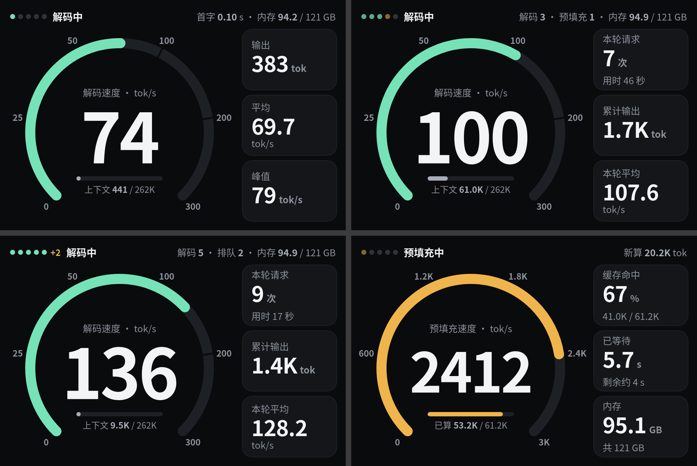
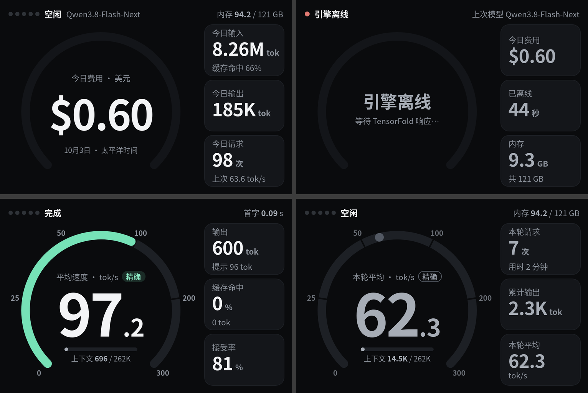
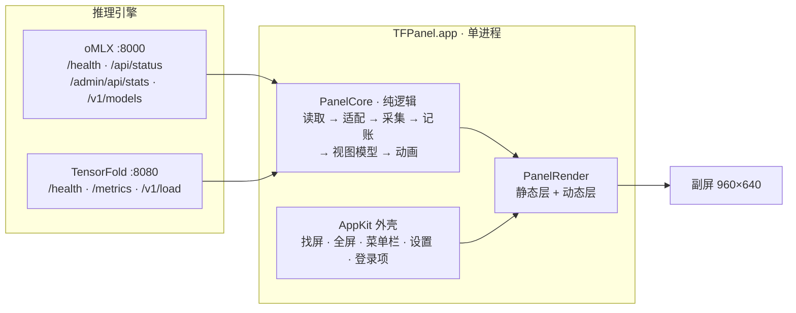
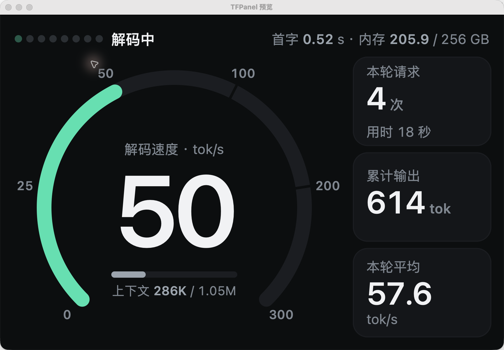
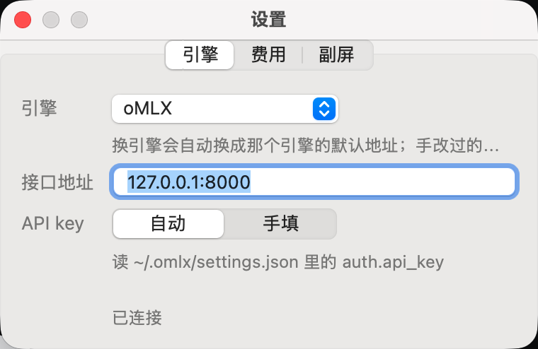

<div align="center">

# TFPanel

### 本地 LLM 推理的副屏仪表盘

把一块 3.5 英寸、960×640 的小副屏变成推理服务器的实时仪表：**解码速度、预填充进度、并发流、今日用量与费用**，一眼看清模型在干什么。



<sub>960×640 画面：单流解码 · 3 条解码 + 1 条预填充 · 5 条解码 + 2 条排队 · 预填充</sub>


</div>

---

## 为什么做这个

推理服务器（DGX Spark、Mac Studio）通常塞在角落，没有自己的显示器，想知道「现在跑得快不快、花了多少钱」得开网页或 SSH 去看。拓展坞上那块副屏却一直空着。

TFPanel 把这块屏变成一台常驻仪表：窗口自动铺满副屏、不抢焦点、不吃点击，拔掉副屏就自动收起来。模型那边什么都不用改——客户端照常连原来的端口，仪表只是旁路读取状态接口。

## 一眼能看到什么

| | |
| --- | --- |
| **解码速度** | 270° 圆弧 + 主数字，实时 tok/s；并发时右侧换成「本轮请求 / 累计输出 / 本轮平均」 |
| **预填充** | 琥珀色圆弧、进度条（已算 / 总量）、缓存命中率、已等待与预计剩余 |
| **流指示点** | 绿点 = 解码中，琥珀点 = 预填充中，灰点 = 空闲；有排队时追加「+2」 |
| **上下文** | 每条流的 KV 占用条：80% 以下灰、80–95% 琥珀、95% 以上红 |
| **今日账单** | 今日费用（按各模型自己的 API 单价折算）、输入 / 输出 token、缓存命中、请求数 |
| **引擎状态** | 模型名 + 引擎名、首字延迟、内存占用；断连 3 次后显示离线与上次模型 |

<details>
<summary><b>完整状态表</b>（离线 / 空闲 / 预填充 / 解码 / 完成 / 模型加载中）</summary>

| 状态 | 圆圈里 | 右侧三栏 |
| --- | --- | --- |
| 引擎离线 | 「引擎离线 / 等待引擎响应…」，底环变暗 | 今日费用 / 已离线时长 / 内存；状态条写上次模型和引擎 |
| 空闲（今日统计） | 今日费用（`$0.60`），下面写日期和时区 | 今日输入（缓存命中 x%）/ 今日输出 / 今日请求（上次 tok/s） |
| 预填充中 | 前 3 秒保持上一画面，状态条写「已用时 x.x s」；之后换预填充画面，琥珀弧 + 进度条 | 缓存命中 / 已等待 / 内存 |
| 解码中 | 解码速度，薄荷绿弧 + 上下文占用条 | 输出 / 平均 / 峰值；并发时换本轮统计 |
| 完成（停 4 秒） | 平均速度，带「精确」标记 | 输出 / 缓存命中 / 接受率 |
| 模型加载中 | 加载进度条、「已用 / 预计」秒数（oMLX 按需加载时出现） | — |

间隔不超过一轮阈值（默认 60 秒）的新请求算同一「一轮」；一轮里请求数 ≥ 2 时右侧固定为本轮统计，本轮结束才切回今日统计。

</details>



<sub>空闲账单 · 引擎离线 · 完成画面 · 一轮结束后的统计</sub>

## 架构

一个进程，三层职责：**读 → 算 → 画**。换引擎只换最前面的一小段。



核心设计是**统一读数**：每个引擎写一个适配器，把自家五花八门的状态接口转成同一个结构（在跑几条、每条流的阶段与进度、累计 token、首字时间、上下文占用……）。后面的采集器、今日记账、视图模型、动画完全不认识具体引擎，接第三个引擎时一行都不用改。

| 引擎 | 状态接口 | 特点 |
| --- | --- | --- |
| oMLX | `/api/status` + `/admin/api/stats` | 每条流的预填充进度、缓存命中、模型加载进度都是引擎实报；适配器只需补开始时刻与首字时间 |
| TensorFold | `/health` + Prometheus `/metrics` + `/v1/load` | 字段几乎原样直取；native 版没有逐流明细，预填充进度用聚合值，上下文条用每流 KV 占用 |
| vLLM（Spark 版） | Prometheus `/metrics` | 累计值齐全，逐流进度靠估算；断开的请求不计入完成数，已用 token 计入账单 |

所有读数失败都走**降级路**而不是崩溃：字段缺了少显示一块，引擎不响应就切离线画面，3 次读不到才判定离线，恢复后自动重连。

## 两种实现

| | Mac 版（当前） | Spark 版（v2，`spark-v2` 分支） |
| --- | --- | --- |
| 形态 | Swift 6 单进程 app，只有菜单栏图标（`LSUIElement`），双击即用 | Python + GTK 4 命令行进程，随桌面会话启动 |
| 引擎 | oMLX、TensorFold native | TensorFold（Docker）、vLLM |
| 副屏 | 接上自动切到 960×640、全屏铺满；拔掉自动关窗 | 同左 |
| 设置 | 菜单栏 + 三页设置窗口（引擎 / 费用 / 副屏），改完立刻生效 | `~/.config/tfpanel/config.json` |
| 逐流明细 | 靠引擎自己的接口 | TensorFold 容器内打一个小外挂，给 `/health` 补每流进度 |

Mac 版是把约 2,900 行 Python 逻辑逐模块翻译成 Swift 的产物：`PanelCore` 只依赖 Foundation、不读时钟（时刻由调用方传入），同样的输入必然得到同样的输出；`PanelRender` 用 Core Graphics / Core Text 手画；AppKit 外壳负责找屏、切分辨率、菜单栏、登录项与打包。

<table>
<tr>
<td width="58%"></td>
<td width="42%"></td>
</tr>
<tr>
<td align="center"><sub>Mac app 实拍：解码中，数据来自本机 oMLX</sub></td>
<td align="center"><sub>设置窗口：引擎、地址、API key</sub></td>
</tr>
</table>

## 工程上值得说的几处

**1. 渲染分层，静止时完全不重画。** 背景、卡片、标题、刻度这些静态内容只在画面数据变化、淡入结束、屏幕缩放变化时整幅重画；仪表弧、流点、进度条、主数字走动态层，按动画帧率重画。画面静止时两层都停，空闲 CPU 占用低于 1%，解码中低于 5%。

**2. 记账按「累计值的差」而不是按事件。** 引擎重启会改变累计值，所以账本记录上一次读到的累计值作为基线；副屏程序没在跑的那段时间，重启后按基线把用量补上。今日用量按模型分开记，费用按各模型自己的单价算；时区可选跟随系统 / 北京时间 / 太平洋时间，「今日」按所选时区的 0 点切日，切换时区时账本跟着换日。

**3. 中断请求也要算钱。** oMLX 解码中断开时累计值完全不变，适配器自己数断开次数并把已输出 token 记进「断开带走的用量」；TensorFold 会主动感知断开，已生成 token 自动进累计值；vLLM 则是断开不计完成数但 token 已计入。三种语义最后都落到同一本账上。

**4. 一条命令出 app。** `mac/scripts/build-app.sh` 做 release 构建、写 `Info.plist`、ad-hoc 签名，产出 `mac/dist/TFPanel.app`；目标机器不需要装 Swift 或 Python。

## 验证

- **318 条 Swift 测试**（swift-testing，`swift test` 全过）：Python 测试逐条翻译、断言不改，`fixtures/` 里的指标快照两边共用，视图模型输出逐字段对照。
- **Python 版**约 250 条 unittest（采集、适配、记账、视图模型、绘制），在 Spark 上跑。
- **端到端实测**在 Mac Studio（256 GB）上完成 14 个场景，覆盖双引擎切换、10 并发、客户端中断、断连重连、单实例守卫，附 12 张实拍与测试报告：[`docs/tensorfold-e2e/测试报告.md`](docs/tensorfold-e2e/测试报告.md)。

## 快速开始

**Mac 版**（需要 macOS 14+ 和 Swift 6 命令行工具）：

```sh
mac/scripts/build-app.sh      # 产出 mac/dist/TFPanel.app
open mac/dist/TFPanel.app     # 或拷到 /Applications 后双击
```

菜单栏图标点开即可配置：引擎（oMLX / TensorFold）、地址、API key、时区、费用单价、自动切换 960×640、登录时启动。oMLX 的 key 默认自动读 `~/.omlx/settings.json`；TensorFold 要读 metrics 时启动加 `--metrics-open`，或在设置里手填 key。

**Spark 版**（在 MacBook Pro 上同步，在 Spark 上启动）：

```sh
scripts/sync.sh
~/tfpanel/scripts/tfpanel.sh start
```

完整安装、开机启动、外挂、更新卸载见 [`docs/design.md`](docs/design.md)；vLLM 增补见 [`docs/design-vllm.md`](docs/design-vllm.md)。

## 目录

```
mac/            Swift 包：PanelCore（纯逻辑）、PanelRender（绘制）、TFPanel（app）、两组测试
panel/          Spark 版 Python 实现，Mac 版翻译时的参照
hook/           TensorFold 容器外挂（Spark 版用）
fixtures/       各状态的指标快照样例，测试与离屏截图共用
scripts/        同步到 Spark、开机启动项、副屏程序管理、离屏截图
docs/           设计文档、可交互原型、实拍截图、端到端报告、任务说明
```

## 文档

- 设计文档（Mac 版，当前）：[`docs/design-mac.md`](docs/design-mac.md)
- 可交互原型：[`docs/dashboard-prototype.html`](docs/dashboard-prototype.html)（浏览器直接打开；`?kiosk=1` 只显示屏幕，`&demo=<名字>` 停在某个画面）
- 原型实拍：[`docs/prototype-shots/`](docs/prototype-shots/)
- Spark 版设计：[`docs/design.md`](docs/design.md) · vLLM 增补：[`docs/design-vllm.md`](docs/design-vllm.md)
- 端到端测试报告：[`docs/tensorfold-e2e/测试报告.md`](docs/tensorfold-e2e/测试报告.md)

## 已知限制

- 只做了单机、单显示器；远程引擎地址可以填，但不保证也不测试。
- TensorFold native 没有逐流明细，并发时看不到每条流各自的预填充进度。
- ad-hoc 签名：换机器第一次打开可能被 macOS 拦一次，用 `scp`/`rsync` 拷贝并在「隐私与安全性」放行即可。
- 副屏切 960×640 用的显示模式接口私有程度较高，未来 macOS 若收紧会在菜单栏提示手动切换。
