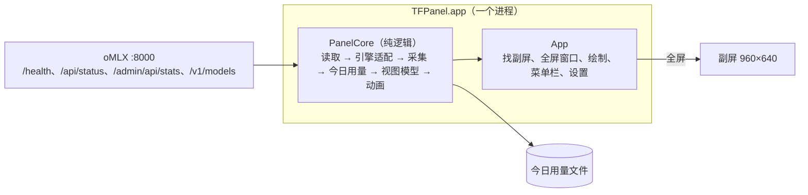

# 副屏性能仪表盘 · 设计文档（第 3 版 · Mac）

> 2026-10-29。副屏和模型都搬到 Mac Studio 上，只做 Mac 版。本文取代 Spark 版的两份文档（`design.md`、`design-vllm.md`）成为当前版本。
> **画面和规则全部沿用 Spark 版**：状态、并发、一轮、短预填充、今日用量和费用、刻度、字号、动画，都以 Spark 版文档和 `panel/` 里的 Python 实现为准，本文只写 Mac 上不一样的地方。
> 界面以同目录下的原型 `dashboard-prototype.html` 为准；本文与原型冲突时以原型为准。
> 状态：设计文档和原型已确认（2026-10-29），开始实现。

## 背景与目标

| 项目 | Spark 版（第 2 版） | Mac 版（本版） |
| --- | --- | --- |
| 推理机器 | DGX Spark，TensorFold / vLLM 跑在 Docker 里 | Mac Studio（256 GB），引擎直接装在 macOS 上 |
| 引擎 | TensorFold 0.6.1（CUDA）、vLLM | **oMLX**。设置里选引擎，这一版只有 oMLX 一项 |
| 副屏接在哪 | Spark 的 C 口 | Mac Studio |
| 副屏程序 | Python + GTK 4，命令行启动 | **Mac app**：双击打开，菜单栏里设置，可以登录时启动 |
| "今日"按什么时区 | 配置文件里写，默认太平洋时间 | 菜单栏里选：跟随系统 / 北京时间 / 太平洋时间 |
| 费用单价 | 配置文件里一组，默认 Qwen3.8 的价格 | **每个模型一组，自己查了 API 价格填**，菜单栏里就能打开 |

目标：

- 副屏上的画面和 Spark 版一模一样（换了引擎的地方见下文）。
- 不用命令行：装好之后只跟菜单栏图标打交道。
- 引擎在设置里选。这一版只把 oMLX 做好；以后接别的引擎（TensorFold、vLLM 等）就是在这里多一项，再写一个适配器。

本版不做：

- vLLM、TensorFold（Mac 版和 CUDA 版都不做）。TensorFold 正在快速迭代，等它稳定了再接；适配器的写法留着，以后照 oMLX 的方式加。
- 监控别的机器上的引擎（地址可以填远程的，但不保证、不测试）。
- 每条流各自的速度、GPU 功耗和温度（和 Spark 版一样不做）。
- 上架、公证：只给自己用，本机 ad-hoc 签名。

## 硬件与环境

2026-10-29 在开发用的 MacBook Pro 上实测。Mac Studio 明天到，到了补一列。

| 项目 | MacBook Pro（开发、实测） | Mac Studio（正式使用） |
| --- | --- | --- |
| 芯片、内存 | M5 Pro，48 GB | 256 GB（其余到货后补） |
| 系统 | macOS 26.7.1 | 待补 |
| 开发工具 | Swift 6.4（命令行工具）；也装了 Xcode | 只需要运行 app，不需要开发工具 |
| oMLX | 0.7.2，`/Applications/oMLX.app`，端口 8000，最多 8 个请求同时跑 | 待补 |

副屏（2026-10-29 接到 MacBook Pro 上看到的）：

| 项目 | 实测值 |
| --- | --- |
| 系统里的名字 | `TYPE-C` |
| 接上时的默认模式 | 960×540 HiDPI（按 1920×1080 渲染再压到面板上，比例不对、发糊） |
| 要切到的模式 | **960×640，1 倍**（正好等于面板像素）。第 1 版的 app 接上副屏时自动切过去，本版照搬 |
| 面板 | 3.5 英寸，960×640，3:2，约 330 PPI |

画面仍按 **480×320 pt、2 倍像素**设计。macOS 上 960×640 是 1 倍模式，所以程序自己把全部尺寸乘 2，和 Spark 版一样。

## 整体架构



全部用 **Swift** 写，一个进程：

- **PanelCore**：纯逻辑，只依赖 Foundation，不读时钟（时刻由调用方传入），同样的输入得到同样的输出。从 `panel/` 的 Python 模块逐个移植。
- **App**：AppKit 窗口 + Core Graphics / Core Text 手画，外壳（找屏、铺满、不抢焦点、切分辨率、登录项、打包）从第 1 版的 Swift 代码（git 提交 `6c9ad9a` 的 `display/`）拿过来改。

为什么全用 Swift：只做 Mac，不再需要和 Spark 共用代码；一个进程、一种语言，打包最简单，不用往 app 里塞一份 Python。代价是要把约 2,900 行 Python 逻辑翻译一遍，但这部分有 4,000 行测试和 `fixtures/` 里的样例可以逐条对照，翻译出错能被测出来。

### 从 Spark 版搬什么

| Python 模块（`panel/`） | Mac 版 | 怎么搬 |
| --- | --- | --- |
| `sources.py` 读取 | `PanelCore/Sources.swift` | TensorFold 的 `/health`、`/metrics` 解析不要了；新增 oMLX 的读取（见下）。HTTP 用 `URLSession`，超时 0.5 秒，复用连接 |
| `engine.py` 引擎识别、适配 | `PanelCore/Engine.swift` | 不再自动识别，按设置里选的引擎读（见“引擎的选择”）；新写 oMLX 适配器；vLLM 适配器不搬 |
| `collector.py` 采集 | `PanelCore/Collector.swift` | **原样翻译**，行为一字不变；只加一处：统一读数带 `loading` 时进入新状态“模型加载中”（见“引擎：oMLX”） |
| `usage.py` 今日用量 | `PanelCore/Usage.swift` | 翻译，改两处：时区换成设置里选的（见“时区”）；用量按模型分开记，费用按各模型自己的单价算（见“费用单价”） |
| `viewmodel.py`、`view.py`、`fmt.py`、`scale.py` | `PanelCore/ViewModel.swift` 等 | 原样翻译；改几处文字（引擎名、时区名） |
| `anim.py` 动画 | `PanelCore/Animator.swift` | 原样翻译 |
| `poller.py` 轮询 | `App/Poller.swift` | 频率不变；放在后台线程，结果交给主线程 |
| `config.py` 配置文件 | `App/Settings.swift` | 改成 `UserDefaults`，在菜单栏和设置窗口里改（见“设置”） |
| `render.py`（cairo + Pango） | `App/Renderer.swift` | 用 Core Graphics + Core Text 照着画，坐标、字号、颜色一样 |
| `app.py`（GTK 窗口） | `App/ScreenManager.swift` 等 | 用第 1 版的外壳 |
| `/proc/meminfo` | `PanelCore/Memory.swift` | 用第 1 版的读法（`host_statistics64`，和活动监视器一致） |
| `hook/`、`scripts/` | — | 不要了 |

翻译的规矩：

- Python 的测试逐条翻成 Swift 测试（swift-testing），断言不改。和 Spark 专用的东西有关的测试（vLLM、容器外挂、GTK）不翻。今日用量改成按模型记，相关测试的断言跟着改，改了哪几条在任务说明里列出来。
- 采集器、视图模型里给 TensorFold 外挂失效、vLLM 估算进度写的分支照样翻译，不删：oMLX 正常时用不到，但 `/admin/api/stats` 读不到、只有 `/api/status` 的时候还要靠“没有明细”的降级路显示“已用时”。原型里不再单独演示这些画面。
- `fixtures/` 里的快照样例两边共用：Swift 版吃同样的 JSON，视图模型的输出要和 Python 版一样。
- `panel/` 在移植期间留在仓库里当参照，Mac 版验收通过后再删掉（见“仓库结构”）。

## 引擎：oMLX

oMLX 自己就把每个请求的进度放在接口里，**不需要外挂**，装好就能读。

### 能读到什么（2026-10-29 在 MacBook Pro 上实测）

oMLX 0.7.2，模型 `Qwen3-4B-Instruct-2507-4bit`，每 0.1 秒读一次，跑了单条短请求、约 3 万 token 的长提示、带缓存的追问、4 条并发、10 条排队、解码中断开、预填充中断开七种情况。

| 接口 | 要不要 key | 耗时 | 给什么 |
| --- | --- | --- | --- |
| `GET /health` | 不要 | 约 1 毫秒 | `{"status":"healthy","default_model":…,"engine_pool":{…}}`，用来认出 oMLX |
| `GET /api/status` | 要 | 约 1 毫秒 | 累计值：`total_requests`、`total_prompt_tokens`、`total_cached_tokens`、`total_completion_tokens`；当前：`active_requests`、`waiting_requests` |
| `GET /admin/api/stats` | 要 | 中位 8 毫秒，p95 25 毫秒；模型加载时最长 450 毫秒 | `active_models.models[]`：每个模型的 `is_loading`、加载已用和预计秒数，以及三张表（见下） |
| `GET /v1/models` | 要 | 约 1 毫秒 | 每个模型的 `id` 和 `max_model_len`（上下文上限） |

key 就是 oMLX 的 API key，写在 `~/.omlx/settings.json` 的 `auth.api_key`，请求时放 `Authorization: Bearer <key>`。

`/admin/api/stats` 里每个模型有三张表，每行都带 `request_id`，同一个请求从排队、预填充到解码 `request_id` 不变：

| 表 | 每行的字段 | 实测行为 |
| --- | --- | --- |
| `waiting` | `queue_position`、`elapsed_seconds`（从到达算起）、`prompt_tokens` | 超过 8 条（`max_concurrent_requests`）才有 |
| `prefilling` | `processed`、`total`、`speed`、`eta`、`cached_tokens`、`prompt_tokens` | 按块更新：单独跑时每块 2,048 token、约 1.1～2 秒一次；有别的流在解码时块变小（512～1,280）。**第一块算完才出现这一行**；提示短于一块、或者几乎全部命中缓存时根本不出现 |
| `generating` | `generated_tokens`、`tokens_per_second`、`elapsed_seconds`（从开始解码算起）、`prompt_tokens`、`max_tokens` | `generated_tokens` 每 0.1 秒都在变；没有缓存命中数 |

其他实测结论：

- **累计值只在请求结束时变**，和 TensorFold 的语义一致；解码中的实时输出只能从 `generating` 行里读。
- **请求到了、行还没出来**：长提示在第一块算完前（约 1 秒），`/api/status` 的 `active_requests` 已经是 1，三张表都还没有它。短请求一般 0.1 秒内就直接出现在 `generating` 里。
- **解码中断开**：行在 0.1 秒内消失，**累计值完全不变**（这个请求的提示和已输出的 token 都不算进 `total_*`）。
- **预填充中断开**：oMLX 察觉不到，照样算完预填充、把 `max_tokens` 生成完，按正常结束计入累计值。副屏如实显示成一个正常请求。
- **模型按需加载**：第一个请求到来时才加载（4B 模型约 1.3 秒），这期间 `is_loading` 为真并给出已用秒数和预计秒数。闲置一段时间后 oMLX 可能卸载模型，下一个请求又要加载。
- 没有推测解码，所以没有接受率。
- 可以同时加载几个模型，请求分属不同模型。

### 适配器

oMLX 适配器每次读数读 `/api/status` 和 `/admin/api/stats`（合计约 10 毫秒），交给采集器的仍是“统一读数”（定义见 `design-vllm.md` 的“统一读数”一节）。和 vLLM 适配器比，这里每条流的进度都是 oMLX 给的真实值，只有开始时刻、首字时间和两项累计秒数要适配器自己记。

**流表。** 三张表里所有模型的行合在一起，按 `request_id` 记成流表，每行合成一个外挂行：

| 外挂行字段 | 怎么来 |
| --- | --- |
| `id` | 适配器给每个新出现的 `request_id` 编的序号 |
| `phase` | 在 `prefilling` 里是 `prefill`，在 `generating` 里是 `decode`；`waiting` 里的行不进外挂行，只算进 `waiting` 个数 |
| `prompt` | `prompt_tokens` |
| `cached` | 预填充行的 `cached_tokens`；解码行沿用它在预填充时的值，没见过预填充就是 0（结束后的真实命中数从累计值的差得到） |
| `filled` | 预填充行的 `processed`（不小于 `cached`）；解码行等于 `prompt` |
| `output` | 解码行的 `generated_tokens`，预填充行为 0 |
| `start` | 第一次见到这个请求时定下，以后不变：在 `waiting` 里见到 → 现在 − `elapsed_seconds`；否则如果有“行还没出来”的占位 → 取最早那个占位的开始时刻；否则 → 这次读数的时刻 |
| `ttft_s` | 第一次在 `generating` 里见到时算：现在 − `elapsed_seconds` − `start`（误差在一次轮询以内） |

**占位。** `active_requests` 比流表里预填充、解码的行数多出几个，就记几个“行还没出来”的占位，开始时刻是第一次多出来的那次读数。有占位时这次读数**不带 `tfpanel`**，采集器走降级路——和 vLLM 的“提示未知”同一个处理。占位最多存在约 1 秒，而短预填充阈值是 3 秒，所以画面上看不出来。

**结束和断开。** 一行从三张表里消失：

- 同一次读数里 `total_requests` 增加了 → 算正常结束。增加了 k 而消失了 k 行以上时，取最早的 k 行算结束。
- 否则 → 算中途断开：`aborted_total` 加 1；它的提示和已输出 token 记进“断开带走的用量”（见下面的 `usage_totals`），因为 oMLX 自己不算。

**两项累计秒数。** 正常结束的行，把它最后一次读到的 `elapsed_seconds`（解码用时）加进 `decode_seconds_total`，把 `ttft_s` 减去排队时间加进 `prefill_seconds_total`。完成画面的“解码速度”“预填充速度”就是用这两项算的，误差在一次轮询以内。

**统一读数各字段：**

| 字段 | oMLX 怎么来 |
| --- | --- |
| `ok`、`backend` | 恒为真；`omlx` |
| `requests_running` | `/api/status` 的 `active_requests` |
| `streams.decoding`、`.prefilling` | 流表里解码、预填充的行数（占位算预填充） |
| `streams.max` | 8。读不到设置时也用 8（oMLX 的默认值） |
| `requests_total` | `total_requests` |
| `prompt_tokens_total`、`cached_tokens_total` | `total_prompt_tokens`、`total_cached_tokens` |
| `completion_tokens_total` | `total_completion_tokens` + 流表里解码行的 `output` 之和（实时） |
| `prefill_seconds_total`、`decode_seconds_total` | 适配器自己累计，见上 |
| `drafted_total`、`accepted_total` | 0 |
| `context_length` | 当前请求所属模型在 `/v1/models` 里的 `max_model_len`；读不到用 262,144 |
| `tfpanel` | 流表合成的外挂行；有占位时不带 |
| 新 `epoch` | `/api/status` 的“现在 − `uptime_seconds`”，取整到 10 秒（oMLX 重启后会变） |
| 新 `aborted_total` | 适配器数的断开次数 |
| 新 `completion_finished_total` | `total_completion_tokens` |
| 新 `usage_totals` | `{prompt, cached, completion, requests}` = 四项累计值 + 断开带走的提示和输出（`requests` 不加断开的）。这样今日用量和 Spark 版一样把断开请求已经花掉的 token 算进去 |
| 新 `usage_by_model` | 同样四项，按模型分开的累计值（见“费用单价”）；各模型加起来等于 `usage_totals` |
| `waiting` | `waiting_requests` |
| `ttft_sum`、`ttft_count` | 正常结束的行的 `ttft_s` 累计，结束时才加 |
| `kv_usage` | 空列表 |

**模型加载中。** 任何一个模型 `is_loading` 为真 → 统一读数加一个新字段 `loading: {model, elapsed_s, estimated_s}`，画面显示新增的“模型加载中”（见原型），带进度条和“已用 / 预计”秒数。加载期间进来的请求照常记占位，加载完接着走预填充。

**模型名。** 有请求在跑时显示最近开始的那条流所属的模型；空闲时显示最近一次用过的模型，还没用过就显示 `/health` 的 `default_model`。模型名里的 `mlx-community--` 这类前缀照 Spark 版的规矩去掉。

**刻度上限。** 并发上限 8，和 Spark 版 TensorFold 的 8 条流一样，并发画面不用改。

## 引擎的选择

不再自动识别。设置窗口里有一个“引擎”下拉框，选哪个就按哪个的方式读；这一版下拉框里只有 **oMLX** 一项。

- 每个引擎带自己的默认地址（oMLX 是 `127.0.0.1:8000`），可以手改。
- 每次轮询照选的引擎读。读到了但不像这个引擎（oMLX：`/health` 不是带 `engine_pool` 的 JSON）→ 画面显示离线，菜单栏的引擎一项写“这个地址上不是 oMLX”。
- `/api/status` 返回 401 → 画面显示“oMLX 需要 API key · 在设置里填写”，菜单栏的引擎一项也写这句。
- 连续 3 次读不到 → 离线，和 Spark 版一样；适配器的状态清空，重新连上后从头记。
- 换引擎或改地址：立刻生效，相当于引擎重启（今日用量不受影响，账本按引擎启动标记接着算）。

**以后接新引擎。** 各家的 OpenAI 兼容接口只管收发对话，不报告“正在跑几条、算到哪了”，所以做不出一个通用适配器——每家的状态接口都不一样（oMLX 有 `/admin/api/stats`，vLLM 有 Prometheus `/metrics`，有的什么都没有）。能做到的是把引擎相关的部分压到最小：一个新引擎 = 下拉框里多一项（名字、默认地址、要不要 key）+ 一个把它的状态接口转成统一读数的适配器，采集器以后的部分一行不改。

- **TensorFold**：等它稳定了再接。第 1 版的 Mac 外挂（git 提交 `6c9ad9a` 的 `collector/`）可以拿来参考，但挂载点要对照那时的新版重新核实。
- **vLLM**：Spark 版的适配器（`panel/engine.py`）可以照着翻。
- 只有收发接口、没有状态接口的引擎（例如 LM Studio、Ollama）只能在中间加一层代理来看到请求，到时候单独设计。

## 费用单价

不同模型的 API 价格不一样，所以单价**按模型填**，由你自己查了填进去，程序不带任何默认价格。

**在哪填。** 菜单栏里有“费用单价…”，打开设置窗口的“费用”一页：一张表，每行一个模型，三列单价（输入、缓存命中、输出，美元 / 百万 token）。表里列出 oMLX `/v1/models` 里的所有模型，加上以前用过、现在已经删掉的模型（灰色，可以删）。没填的格子是空的。

**怎么记账。** 今日用量从“一个总数”改成“每个模型一份”：

- 适配器在请求结束时知道它是哪个模型的，把这次累计值的增量记到这个模型名下，得到统一读数里的 `usage_by_model`。同一次读数里有几个不同模型的请求一起结束时，增量按这几行的提示长度比例分（同一个模型的请求一起结束不影响）。断开带走的用量记在它自己的模型名下。
- 账本（`usage.json`）按模型分开存四项，算法和 Spark 版一样（按累计值的差记账，引擎重启从新基线算）。历史文件每天一行，行里带各模型的明细。
- 今日费用 = 各模型的用量 × 各自的单价，加起来。改单价立刻重算今天（历史不改，历史行里存的是当时算出的费用）。

**没填单价时。**

| 情况 | 空闲画面 |
| --- | --- |
| 今天用过的模型都填了 | 和 Spark 版一样 |
| 有的填了、有的没填 | 主数字只算填了的；圆圈下面那行变成 `10月29日 · 北京时间 · 不含 1 个模型`（琥珀色） |
| 今天用过的模型一个都没填 | 主数字写 `—`；下面那行写 `未填单价 · 在菜单栏里填`（琥珀色） |

离线画面的“今日费用”一格同样处理。今日输入、输出、请求数不受单价影响，照常显示。

货币仍是美元，显示“今日费用 · 美元”，不随时区变。

## 设置

不再有配置文件。常用的放菜单栏，填数字的放设置窗口，其余的调试项只能用 `defaults write` 改。改了立刻生效，不用重启 app。

### 菜单栏

菜单栏上一个小仪表图标（第 1 版那个），点开：

| 菜单项 | 说明 |
| --- | --- |
| 副屏：TYPE-C · 960 × 640 | 只显示，不能点。没接副屏时写“副屏：未找到 TYPE-C” |
| 引擎：oMLX · 127.0.0.1:8000 | 只显示。没连上时写“引擎：未连接” |
| 时区 ▸ | 子菜单，三选一：**跟随系统（北京时间）**、北京时间、太平洋时间。括号里是系统时区现在对应的名字 |
| 费用单价… | 打开设置窗口的“费用”一页。当前模型没填单价时后面写“（当前模型未填）” |
| 自动切换到 960 × 640 | 勾选项，默认开。接上副屏时不是这个模式就自动切过去 |
| 登录时启动 | 勾选项，默认关 |
| 设置… | 打开设置窗口（⌘,） |
| 退出 | ⌘Q |

### 设置窗口

一个小窗口，顶上三页：

| 页 | 项 | 默认值 |
| --- | --- | --- |
| 引擎 | 引擎：下拉框，这一版只有 oMLX | oMLX |
| | 接口地址 | `127.0.0.1:8000` |
| | API key：自动（读 `~/.omlx/settings.json` 里的 `auth.api_key`），或者手填 | 自动 |
| 费用 | 每个模型三个单价（见“费用单价”） | 空 |
| 副屏 | 屏幕名 | `TYPE-C` |

### 只能用 `defaults write` 改的

一轮间隔（60 秒）、短预填充阈值（3 秒）、完成停留（4 秒）、空闲多久调暗（30 分钟）、动画帧率（10）。键名和 Spark 版配置文件的键名相同，例如：

```sh
defaults write com.tensorfold.panel round_gap_s -float 30
```

## 时区

“今日”从所选时区的 0 点算起；空闲画面圆圈下面那行写日期和时区名，例如 `10月29日 · 北京时间`。

| 菜单里选的 | 实际用的时区 | 画面上的名字 |
| --- | --- | --- |
| 跟随系统（默认） | 系统时区，系统里改了时区跟着变 | 系统时区是 `Asia/Shanghai` 写“北京时间”，`America/Los_Angeles` 写“太平洋时间”，其他时区用系统给的中文名（例如“日本标准时间”） |
| 北京时间 | `Asia/Shanghai` | 北京时间 |
| 太平洋时间 | `America/Los_Angeles`（自动处理夏令时） | 太平洋时间 |

中途换时区：立刻生效。换完之后按新时区算出的“今天”和账本里的日期一样，就接着累计；不一样，就按换日处理——账本里已有的那天记进历史，今天从 0 开始。所以在两个时区日期不同的时段里来回切，历史里同一天可能出现两笔。换时区是很少做的事，接受这一点。

## 打包、安装、登录时启动

- **构建**：在 MacBook Pro 上，仓库里一条命令 `mac/scripts/build-app.sh`：release 构建，生成 `mac/dist/TFPanel.app`（含图标、`Info.plist`、ad-hoc 签名）。`Info.plist` 里设 `LSUIElement`：不占 Dock，只有菜单栏图标。
- **拷到 Mac Studio**：用 `scp -r` 或 `rsync` 拷到 Studio 的 `/Applications/`（需要 Studio 打开“远程登录”）。这两种方式不会给文件打隔离标记，双击就能打开。用隔空投送拷的话会被 macOS 拦下（“无法验证开发者”），要在“系统设置 > 隐私与安全性”里点“仍要打开”一次。
- **Studio 上不需要装任何开发工具**，也不需要 Python。
- **登录时启动**：菜单里勾上后用系统的登录项接口（`SMAppService`）登记，在“系统设置 > 通用 > 登录项”里能看到、能关。
- **数据和日志**：今日用量文件放 `~/Library/Application Support/TFPanel/`（`usage.json`、`usage-history.jsonl`，在 Spark 版格式上加了按模型的明细，见“费用单价”）；日志写 `~/Library/Logs/TFPanel.log`，超过 1 MB 时下次启动先清空。
- **只开一个**：已经在运行时再双击，不开第二个。

副屏的行为和第 1 版、Spark 版一样：没接副屏不开窗口，接上自动全屏铺满，拔掉自动关窗口；窗口不抢焦点、不吃点击，盖住副屏上的菜单栏；画面静止时停止重画。

## 仓库结构

在分支 `mac-v3` 上做，新代码全部放在 `mac/` 下：

```
mac/
  Package.swift                 Swift 包：PanelCore（库）、TFPanel（app）、两组测试
  Sources/PanelCore/            纯逻辑：读取、引擎适配、采集、今日用量、视图模型、动画、内存
  Sources/TFPanel/              app：找副屏、窗口、绘制、菜单栏、设置窗口、登录项
  Tests/PanelCoreTests/         Python 测试的翻译 + oMLX 适配器、按模型记账的新测试
  Resources/                    图标、Info.plist
  scripts/build-app.sh          构建出 mac/dist/TFPanel.app
fixtures/
  omlx/                         实测录下的 oMLX 读数序列（新），适配器测试的输入
```

- 测试用 swift-testing，`swift test` 在 MacBook Pro 上跑（命令行工具自带，不需要 Xcode）。
- `fixtures/` 里已有的快照和 vLLM 录音不动，Swift 版测试直接读。
- `panel/`、`hook/`、`scripts/`、`design.md`、`design-vllm.md` 在 Mac 版验收通过之前留着当参照；Mac 版在 Studio 上验收通过后，用一个单独的提交删掉。

## 风险与已知限制

| 风险 | 影响 | 应对 |
| --- | --- | --- |
| 2,900 行 Python 翻成 Swift 时出错 | 画面数字不对 | 测试逐条翻译、断言不改；`fixtures/` 两边共用，视图模型输出逐字段对照 |
| Core Text 和 Pango 排出来的字不完全一样 | 字宽、基线差一两个像素 | 对照 `docs/prototype-shots/` 的实拍逐屏比；以原型为准，不追求和 Spark 版像素一致 |
| oMLX 升级改了 `/admin/api/stats` 的字段 | 读不到进度 | 字段缺了按“没有明细”走降级路，不崩；菜单栏写出 oMLX 版本，方便对照 |
| oMLX 每块才更新一次进度 | 预填充进度一跳一跳（单独跑时约 1～2 秒一跳） | 动画在两次更新之间按 `speed` 往前推，到下一块的位置为止，不超过 |
| 预填充中断开的请求，oMLX 照样算完 | 副屏上显示成正常请求，今日用量也算进去 | 这是 oMLX 的真实行为，如实显示 |
| 多条流并发时，同一次读数里有几行消失、累计请求数只加了一部分 | 哪几条算断开可能猜错 | 只影响断开次数和用量里的少量 token；在跑数回到 0 时流表清空 |
| 几个模型的请求同时结束 | 分到各模型名下的用量可能有少量偏差 | 按提示长度比例分；合计始终是对的 |
| ad-hoc 签名的 app 换了机器 | 第一次打开可能被拦 | 用 `scp`/`rsync` 拷，不走隔空投送；被拦就在“隐私与安全性”里放行一次 |
| 副屏切 960×640 用的是私有程度较高的显示模式接口 | 以后的 macOS 可能不让切 | 第 1 版在 macOS 26 上验证过；切不了就在菜单栏提示手动在“显示器”设置里选 |

## 验收标准

在 MacBook Pro 上（Studio 到了再在 Studio 上重复一遍）：

1. `swift test` 全部通过；翻译过来的测试个数和 Python 那边对得上（去掉不翻的）。
2. `mac/scripts/build-app.sh` 一条命令出 `TFPanel.app`；拷到 `/Applications` 双击能开，只有菜单栏图标，没有 Dock 图标；再双击不会开第二个。
3. 接上副屏自动切到 960×640、全屏铺满；拔掉关窗口，再接上又出来；窗口不抢焦点、不吃点击。
4. 用 oMLX 跑实测时的七种情况（单条短请求、约 3 万 token 长提示、带缓存追问、4 条并发、10 条排队、解码中断开、预填充中断开），副屏画面和原型对应的画面一致；同时截副屏、录读数，逐条核对数字。
5. 模型加载中有“模型加载中”画面；oMLX 关掉 3 次读不到显示离线，重新打开后自动连上。
6. 时区：三个选项都能切；`10月29日 · 北京时间` 这一行跟着变；跨过所选时区的 0 点今日用量清零、昨天记进历史。
7. 费用单价：菜单栏能打开；一个模型都没填时主数字是 `—`；填了之后今日费用立刻变；换一个没填单价的模型跑一次，下面那行出现“不含 1 个模型”。
8. 改 API key、改地址立刻生效。
9. 勾上“登录时启动”，注销再登录后自动运行；取消后不再自动运行。
10. 副屏程序 CPU 占用：空闲时平均低于 1%，解码中低于 5%（活动监视器看）。

## 已定事项

- 只做 Mac，全部 Swift，一个进程（2026-10-29）。
- 这一版只做 oMLX；vLLM、TensorFold 都不做。设置里选引擎，以后接新引擎就是多一项（2026-10-29）。
- 时区三选一，默认跟随系统（2026-10-29）。
- 费用单价按模型由用户自己填，菜单栏里能打开；不带默认价格；货币是美元（2026-10-29）。
- 完成画面第三格：oMLX 没有接受率，放“首字”（2026-10-29）。
- Spark 那套代码（`panel/`、`hook/`、`scripts/`、Spark 的两份文档）等 Mac 版在 Studio 上验收通过后，用一个单独的提交删掉（2026-10-29）。
